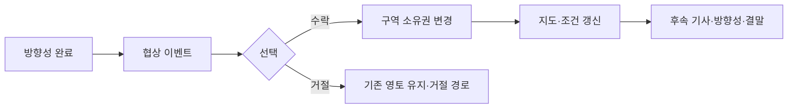

# 시나리오·세계지도 연동 설계

- 상태: **v0.3 — 개발 브랜치에 구현·검증됨, 미배포** · 구현하며 정한 것과 달라진 점은 [12장의 결정·검토 기록](#결정검토-기록), 검증 결과는 [v1.7.1 진행 기록](V1_7_1_PROGRESS.md#4-3단계-세계지도--시나리오-연동)
- 대상 릴리스: **전체 게임 v1.7.1 · 시나리오 v0.3.2** — [전체 계획](V1_7_1_PLAN.md) · [0.3.2 범위](SCENARIO_0_3_2_PLAN.md)
- 작성일: **2026-11-12**
- 설계 때 확인한 코드: `2b11359` / `v1.7.0-obt.3` · 구현 기준 코드: `ab6878c` / `v1.7.0-obt.10` · 시나리오 `0.3.1`
- 목적: 다음 구현 작업을 맡길 때 사용할 공통 설계·작업 지시서

이 문서의 `world`, `worldBindings`, `owns_regions`, `transfer_regions`, `check: "world"`는 **개발 브랜치에 구현되어 있고 배포된 버전(v1.7.0 / 시나리오 0.3.1)에서는 동작하지 않습니다.** 아래 본문은 설계 당시의 글을 유지하되, 구현하며 확정·변경한 내용은 결정·검토 기록에 적었습니다. 사용법은 [시나리오](../CAMPAIGN.md#세계지도-연동-개발-중--v171--032), [세계지도](../WORLD_MAP.md), [스크립트 모드](../MODDING.md)를 참고하세요.

v1.7.1에는 이 연동과 함께 **시나리오 오류 검사 강화·앱 전반 성능 최적화·Steam 시나리오 멀티플레이·지도상의 경제권·시나리오 메이커 확장과 편집 잠금**을 포함합니다. 각 범위와 완료 기준은 통합 작업 계획에서 관리합니다. 경제권은 국가 소유권과 별도의 지역 레이어이며, 멀티의 국가별 진행 분리는 현재 단일 플레이 상태에 추가할 작업입니다. 방향성·결정·기술·군사·경제·무역·자원 제작과 정당/의석 등의 잠금은 [메이커 보완 설계](SCENARIO_MAKER_EXPANSION.md)를 참고하세요.

## 1. 만들고 싶은 플레이

플레이어가 방향성 **국경 협상 개시**를 완료하면 서사 이벤트가 열립니다. **협정을 수락한다**를 고르면 국경 구역이 공화국 영토로 바뀌고, 지도에 공화국의 기존 색이 반영됩니다. 변경된 소유권을 조건으로 후속 기사·방향성·결말이 열립니다.



첫 결과물은 이 작은 시나리오를 **턴제·실시간 모두에서 끝까지 플레이할 수 있는 상태**로 만드는 것입니다.

## 2. 현재 기능과 이번 구현 범위

| 항목 | 현재 코드 | 이번 단계의 목표 |
|---|---|---|
| 세계지도 | `.hemimap` 불러오기·국가별 수동 칠하기·색·지우기·실행 취소 | 효과가 소유권을 변경하고 같은 화면에 반영 |
| 국가 목록 | 세계 › 국가 순위와 공유, 파일 가져오기 때 ID 연결 | 시나리오의 논리적 국가와 실제 국가 ID를 명시적으로 연결 |
| 방향성·이벤트·결정 | 플래그·변수 등 조건과 효과 실행 | 영토 소유 조건과 영토 변경 효과 추가 |
| 이벤트 검사 | 날짜·총선 반영 시 검사 | 지도 변경을 계기로 하는 검사 추가 |
| 제작 화면 | 가이드 폼과 프로 JSON이 같은 데이터 편집 | 국가·구역 선택으로 새 조건·효과 작성 |
| 저장 | 게임 세이브의 `worldMap`, 시나리오의 `campaign` | 소유권·국가 연결을 함께 복원하고 효과 중복 실행 방지 |
| 정적 검사 | 방향성 순환·없는 참조·배타 경로 등 일부 검사 | 국가·구역·시작 나라별 지도 참조 검사 추가 |

이 문서의 첫 단계는 소유권 변경을 합의·방향성·이벤트 결과로 표현합니다. v1.7.1 전체의 군사력·모집·보급·기본 판정 규칙은 메이커 보완 설계에 포함합니다. 세부 군대 이동·점령과 소유의 복잡한 분리·전선·고도 AI는 후속 설계 항목으로 둡니다.

**유지할 기준:** 선거용 지역구·의석·선거 결과, 기존 파일 형식, 기존 턴제/실시간 조작, 네온·라이트·다크 스타일.

## 3. 제작자가 사용하는 흐름

1. 게임의 **세계 › 지도**에서 `.hemimap`을 불러와 초기 영토를 배정하고 `.hemi`로 저장합니다.
2. 시나리오 메이커의 **시작 나라**에서 그 세이브를 선택합니다. 초기 지도는 우선 이 시작 세이브에서 가져옵니다.
3. 시작 나라 화면의 새 **세계지도 연결** 영역에서 논리적 국가를 실제 국가 목록에 연결합니다. 예: `republic` → 공화국.
4. 방향성의 완료 효과 또는 이벤트 선택 효과에서 **영토 변경**을 추가하고 대상 국가·구역을 고릅니다.
5. 후속 방향성·이벤트의 조건에 **구역 소유**를 추가합니다. 이벤트는 발생 시점을 **지도 변경 시**로 선택할 수 있습니다.
6. 검사 후 시험 플레이합니다. 실제 영토 변화·후속 기사·저장 복원을 확인합니다.

가이드에서는 국가명·구역명과 지도 선택을 보여주고, 프로 모드에서는 실제 저장되는 키·JSON을 보여줍니다. 지도에서 여러 구역을 선택하거나 이름으로 검색할 수 있게 하며, 명시적으로 적용하기 전에는 실제 플레이 지도를 변경하지 않습니다.

## 4. 국가·구역 참조와 시작 상태

### 국가 연결 제안

시나리오의 국가 키는 이름과 분리합니다. 이름이 같거나 이름을 바꿔도 서로 다른 국가를 합치지 않습니다.

다음은 시나리오 최상위에 추가할 `world` 조각입니다.

```json
{
  "world": {
    "countries": [
      { "key": "republic", "name": "공화국" },
      { "key": "federation", "name": "연방" }
    ]
  }
}
```

각 기존 `starts` 항목에 다음 필드를 추가합니다. `w_republic` 등은 선택한 시작 세이브의 실제 `history.ranking.rows[].id`를 뜻하는 예시이며, 가이드에서는 목록에서 선택합니다.

```json
{
  "worldBindings": {
    "republic": "w_republic",
    "federation": "w_federation"
  }
}
```

- 여러 시작 나라를 지원하면 각 시작 항목의 연결을 별도로 검사합니다. 세계지도 구역 참조는 선택 가능한 모든 시작 상태에서 유효해야 합니다.
- 실제 국가 ID가 다른 시작 세이브를 사용해도 논리적 키가 같은 물리적 국가를 가리키도록 연결합니다. 플레이어가 바뀌었다는 이유로 공화국 영토를 다른 나라로 바꾸지 않습니다.
- 국가 키는 기존 ID 규칙(영문·숫자·밑줄·점·하이픈)을 사용하며 시나리오 안에서 유일해야 합니다. 같은 실제 ID에 두 국가 키를 연결하면 첫 구현에서는 오류로 처리합니다.
- 국가 이름을 추측해 자동으로 연결하거나 누락된 국가를 효과 실행 중 생성하지 않습니다. 연결을 수정할 위치를 안내합니다.

### 구역과 저장

구역은 기존 `district.svgMap.shapes[].key`를 그대로 참조합니다. 화면 이름은 `district.names.house`에서 가져옵니다. 이름 변경은 참조를 유지하고, 구역 삭제·나누기로 키가 바뀌면 연결을 다시 검사합니다.

초기 지도는 `starts[].state.worldMap`에서 읽고, 플레이 중 상태는 기존 게임 세이브의 `worldMap`에 저장합니다. 선택한 시작 항목의 국가 연결은 실행 상태 `campaign.worldBindings`에 확정해 저장한다는 제안입니다. 이 필드는 신규이며, 현재 작성 데이터인 `campaign.data`와 구분합니다.

지도 파일을 다시 가져왔을 때 현재 연결이 유효한지 확인합니다. 국가 ID 재연결 결과를 알 수 없는 경우 자동으로 다른 나라를 가리키게 하지 않고 **연결 확인 필요**로 표시합니다. 이전 세이브에 이 신규 필드가 없으면 해당 시작 항목의 선언에서 복원하되, 실제 지도·국가를 검증합니다.

## 5. 조건·효과 JSON 제안

아래 코드들은 설명용 JSON 조각이며 완전한 시나리오 파일이 아닙니다. 첫 구현에서는 새 국가 키 참조를 활성 시나리오의 스크립트 문맥에서 지원합니다. 일반 스크립트 모드에는 같은 이름의 키를 임의로 해석하지 않습니다.

### `owns_regions`: 구역 소유 조건

```json
{
  "owns_regions": {
    "country": { "key": "republic" },
    "regions": ["riverbank", "island"],
    "mode": "all"
  }
}
```

- `mode`는 `all`(기본값: 모두 소유) 또는 `any`(하나 이상 소유)입니다.
- 국가·지도·구역이 없으면 바깥 `all`·`any`·`not`를 포함한 조건식 전체를 평가 실패로 처리하고 결과는 거짓으로 둡니다. 참조 유효성을 먼저 점검해 `not`가 잘못된 참조를 참으로 뒤집어 통과시키지 않게 합니다. `any`에서도 존재하지 않는 구역 참조를 무시하지 않습니다.
- `regions`는 비어 있지 않은 고유한 구역 키 배열이어야 합니다.
- 미배정 여부는 `country: { "unassigned": true }`로 명시합니다. 지도 자체가 없는 상태는 미배정 구역으로 취급하지 않습니다.
- 기존 `all`·`any`·`not`, 플래그·변수 조건과 조합할 수 있어야 합니다.

### `transfer_regions`: 영토 변경 효과

```json
[
  {
    "transfer_regions": {
      "regions": ["riverbank"],
      "to": { "key": "republic" }
    }
  },
  { "set_flag": "border_agreement_accepted" }
]
```

`to: { "unassigned": true }`는 배정을 지웁니다. `key`와 `unassigned`를 동시에 쓰는 참조는 오류입니다. 소유권 변경 후 해당 국가의 기존 `worldMap.colors` 색을 사용합니다. 첫 구현에서는 별도의 국가색 변경 효과를 추가하지 않습니다.

## 6. 실행·실패·저장 규칙

1. 효과 실행 전에 선택한 효과 목록의 새 영토 참조를 점검합니다. 조건부 분기의 참조도 점검하되 분기 자체를 미리 실행하지 않습니다.
2. 하나의 `transfer_regions`가 여러 구역을 지정하면 모두 검증한 뒤 소유권을 한 번에 바꿉니다. 일부만 변경하는 결과는 허용하지 않습니다.
3. 참조 검사에 실패하면 해당 행동의 효과 실행 전에 차단합니다. 방향성 완료·결정 사용 기록과 그 목록의 플래그를 먼저 확정하지 않습니다. 이벤트 선택지는 닫거나 대기 목록에서 제거하지 않아 수정 후 재시도할 수 있게 합니다. 이미 창이 열릴 때 처리한 `immediate`는 재실행하지 않습니다.
4. 이미 같은 나라에 속한 구역은 성공한 무변경으로 처리합니다. 실제 변경이 없으면 새 지도 변경 알림을 만들지 않습니다.
5. 성공 후 변경된 구역·국가별 집계·조건을 갱신하고 전체 상태를 저장합니다. 일반적인 영토 변경으로 현재 확대·이동 위치를 초기화하지 않습니다.
6. 저장 복원은 저장된 소유권을 읽습니다. 완료한 방향성·이벤트 효과를 다시 실행해 지도를 재구성하지 않습니다. 반복 가능한 결정의 정상적인 다음 실행은 막지 않습니다.
7. 자동 효과가 적용될 때 진행 중인 수동 붓질을 정리하고 지도 편집의 실행 취소/다시 실행 기록을 비웁니다. 지도에서 실행 취소를 눌러 이벤트 결과만 되돌리고 완료 플래그가 남는 상황을 방지합니다.

원자성 보장은 우선 **한 영토 변경 효과의 구역 목록**을 대상으로 합니다. 기존 경제·여론 등 모든 효과에 대한 전역 롤백은 별도 작업입니다. 참조 오류의 사전 차단과 예상치 못한 실행 오류의 복구를 구분해 구현해야 합니다.

일반 화면에는 “강변 구역을 찾을 수 없습니다. 시작 지도를 확인하세요.”처럼 수정 방법을 보여줍니다. 프로 검사 결과에는 시작 항목·이벤트·선택지·JSON 경로를 함께 표시합니다.

## 7. 지도 변경 후 검사 시점

이벤트의 새 검사 시점은 `check: "world"`로 제안합니다. 가이드 표시명은 **지도 변경 시**입니다. 기존 `date`·`election` 동작을 유지하고, `any`는 지도 변경도 포함합니다.

```json
{
  "id": "border_news_event",
  "title": "새로운 국경",
  "check": "world",
  "trigger": {
    "owns_regions": {
      "country": { "key": "republic" },
      "regions": ["riverbank"]
    }
  },
  "options": [{ "text": "변화를 지켜보자", "effects": [] }]
}
```

- 효과 목록 처리가 끝난 뒤 한 번 검사합니다. 수동 칠하기도 붓질이 끝난 뒤 한 번 검사합니다. 구역마다 이벤트 검사를 반복하지 않습니다.
- 후속 이벤트·조건 기사는 기존 대기열과 일회성 발행 기록을 사용합니다. 지도 상태를 확정하기 전에 이전 소유권으로 검사하지 않습니다.
- 방향성의 선택 가능 상태, 격변 조건·임무·결말도 갱신하되 날짜·턴을 추가로 넘기거나 월별 변화를 추가 적용하지 않습니다.
- 실시간에서는 이벤트·기사 창이 열리면 기존 방식대로 멈춥니다. 턴제도 창을 처리하기 전 다음 턴으로 진행하지 않습니다.
- 검사를 재귀 호출하지 않고 다음 검사 작업으로 모읍니다. `hidden`·`once: false` 이벤트가 서로 영토를 바꾸는 자동 순환에는 실행 상한을 둡니다. 초기 제안은 한 행동당 32회이며, 초과하면 자동 연쇄를 멈추고 관련 이벤트를 알려줍니다.

## 8. 가이드·프로 편집과 검사

| 가이드 항목 | 입력 방식 | 프로 JSON |
|---|---|---|
| 국가 연결 | 논리적 키·이름, 시작 상태의 국가 선택 | `world.countries`, 시작 항목의 `worldBindings` |
| 구역 소유 조건 | 국가/미배정 선택, 구역 다중 선택, 모두/하나 이상 | `owns_regions` |
| 영토 변경 효과 | 구역 다중 선택, 받을 국가/미배정 선택 | `transfer_regions` |
| 이벤트 검사 시점 | 날짜·선거·지도 변경·모든 시점 | `check` |

가이드와 프로 전환·파일 왕복·실행 취소에서 같은 데이터를 유지합니다. 기존 사용자 확장 필드를 삭제하지 않습니다. 모르는 복합 규칙은 기존 방식대로 보존하고 JSON 편집으로 안내합니다.

| 검사 결과 | 처리 |
|---|---|
| 중복 국가 키, 없는 국가 연결, 없는 구역 | 오류: 시험 플레이 전 수정 |
| 시작 지도 누락, 시작 항목별 다른 구역 키 | 오류: 영향을 받는 시작 항목을 표시 |
| 비어 있는 구역 목록, 잘못된 `mode`·참조 형식 | 오류 |
| 자기 영토를 같은 나라로 바꾸는 효과 | 경고: 무변경일 수 있음 |
| 지도 교체·국가 삭제로 기존 연결이 깨짐 | 연결 재검사 및 해당 행동 실행 차단 |
| 외부 상태에 따라 달라지는 복잡한 도달 가능성 | 확정할 수 있는 오류와 경고를 구분 |

모든 시나리오가 반드시 영토를 사용하게 하지는 않습니다. 새 설정·조건·효과가 없는 이전 시나리오는 기존 검사·플레이 경로를 유지합니다.

## 9. 구현 파일과 주의할 현재 동작

| 파일 | 현재 확인 사항과 필요한 변경 |
|---|---|
| [world-map-data.js](../../js/world-map-data.js) | `.hemimap` 검증·정규화 재사용, 소유권 판정·변경 계획을 DOM과 분리 |
| [world-map.js](../../js/world-map.js) | 현재 공개 API는 `state`·`importData`·`show`·`fit`. 효과 적용용 경계를 추가하고 내부 상태 직접 수정으로 끝내지 않기 |
| [scriptmods.js](../../js/scriptmods.js) | 새 조건·효과·`world` 검사 추가, 실패 결과 전달. 현재 결정 사용 기록이 효과보다 먼저 저장되는 순서 검토 |
| [campaign.js](../../js/campaign.js) | 선택한 시작 나라의 연결 확정·복원, 지도 변경 후 조건 재검사. 현재 방향성 완료 플래그가 효과보다 먼저 설정되는 순서 검토 |
| [campaign-events.js](../../js/campaign-events.js) | 현재 선택 콜백 전에 창을 닫음. 사전 검사 실패 시 창·선택지를 유지하는 방식 필요 |
| [campaign-editor.js](../../js/campaign-editor.js), [campaign-guide.js](../../js/campaign-guide.js) | 국가 연결·구역 선택·검사 시점 UI, 프로 JSON 왕복 |
| [campaign-tools.js](../../js/campaign-tools.js) | 새 형식 및 시작 상태의 국가·구역 참조 검사 |

지도 변경 통지의 가칭은 `hemi-world-map-changed`입니다. 이 이름과 위 API 경계는 구현 전 검토 대상이며, 현재 존재하는 기능으로 취급하지 않습니다.

## 10. 첫 예제: 국경 협정

| 설정 | 내용 |
|---|---|
| 국가 | 공화국(`republic`), 연방(`federation`) |
| 초기 영토 | `capital` → 공화국, `riverbank`·`island` → 연방 |
| 방향성 | `open_talks`: 2일 후 `border_talks` 이벤트 표시 |
| 수락 선택 | `riverbank`를 공화국으로 변경하고 수락 플래그 설정 |
| 거절 선택 | 거절 플래그 설정, 지도 유지 |
| 후속 기사 | 수락 플래그와 공화국의 `riverbank` 소유를 모두 만족하면 한 번 발행 |
| 후속 방향성·결말 | 수락/거절 경로를 각각 열고, 결말 2개 제공 |

턴제에서는 두 번 다음 턴 후, 실시간에서는 48시간 진행 후 협상이 열립니다. 영토 효과는 선택한 즉시 반영하고 다음 날짜를 기다리지 않습니다. 변경 대상에 넣지 않은 `capital`·`island`는 원래 소유권을 유지해야 합니다.

초안 검토 단계에서는 이 예제를 플레이 가능한 제작물로 등록하지 않습니다. 기능 구현 뒤 실제 `.hemicmp` 예제로 만들고 폼·JSON·내보내기·불러오기를 검증합니다.

## 11. 작업 순서와 완료 기준

- [x] 1단계: 시작 지도·논리적 국가·실제 ID 연결 및 구역 참조 검사 — `js/campaign-tools.js`(검사), `js/campaign.js`(연결 확정·복원)
- [x] 2단계: `owns_regions`·`transfer_regions`와 순수 데이터 검증 — `js/world-rules.js`, `tests/world-rules.test.cjs`
- [x] 3단계: 효과 실행·실패 처리·저장 복원·지도 변경 검사 연결 — `js/scriptmods.js`, `js/world-map.js`, `js/campaign-events.js`
- [x] 4단계: 가이드 UI·프로 JSON·기존 사용자 데이터 왕복 — `js/campaign-guide.js`, `js/campaign-editor.js`
- [x] 5단계: 국경 협정 예제와 아래 통합 검증 — `docs/example-scenario/`, `tests/world-scenario.browser.cjs`

아래 표의 각 줄을 어떻게 확인했는지는 [진행 기록 4장](V1_7_1_PROGRESS.md#4-3단계-세계지도--시나리오-연동)에 있습니다. **모바일 화면에서의 제작 UI는 따로 확인하지 못했습니다.**

| 검증 | 완료 기준 |
|---|---|
| 한 구역/여러 구역 양도 | 대상만 바뀌고 국가색·집계가 즉시 반영 |
| `all`·`any`·`not`, 미배정 조건 | 빈 지도·없는 구역을 포함해 정의한 결과와 일치 |
| 잘못된 참조 | 구역 일부 변경·가짜 완료 플래그·결정 사용 기록이 남지 않음 |
| 저장·불러오기·다른 세이브 | 영토·국가 연결 복원, 다른 세이브로 새지 않음, 효과 중복 없음 |
| 다른 시작 국가·같은 이름의 서로 다른 국가 | ID 연결대로 유지, 플레이어 국가로 영토가 잘못 바뀌지 않음 |
| 무변경·반복 결정·자동 연쇄 | 무변경 통지 없음, 정상 재실행 가능, 무한 연쇄 차단 |
| 이벤트·기사·격변 | 날짜 추가 진행 없이 조건 갱신, 중복 창·중복 기사 없음 |
| 수동 지도 편집과 자동 효과 | 자동 결과를 옛 편집 실행 취소로 되돌리지 않음 |
| 선거용 지도·이전 파일 | 의석·지역구·선거 결과 유지, 새 기능 없는 파일 호환 |
| 제작 UI·테마·모바일 | 폼/JSON 동일 데이터, 기존 스타일·카메라 조작 유지 |
| 예제 완주 | 턴제·실시간 각각 수락/거절 두 경로를 실제 검증 |

## 12. 구현을 맡길 때의 지시

이 문서를 기준으로 한 단계씩 구현하고, 실제 코드와 다른 부분을 발견하면 문서의 변경 이유·결정 기록도 함께 갱신합니다. 신규 JSON 키를 이미 지원하는 것으로 가정하지 않습니다. 관련 문서와 의미 있는 검증 결과를 남기며, 머지·릴리스·게시는 별도 지시가 있을 때 진행합니다.

### 결정·검토 기록

| 날짜 | 내용 | 상태 |
|---|---|---|
| 2026-11-12 | 첫 목표를 국경 협정 예제의 양도·후속 조건 연결로 설정 | 초안의 기본안 |
| 2026-11-12 | 국가 이름 대신 논리적 키와 시작 상태별 실제 ID 연결 사용 | 초안의 기본안 |
| 2026-11-12 | 기존 `.hemimap`·시작 `.hemi` 경로를 우선 재사용 | 초안의 기본안 |
| 2026-11-12 | 조건·효과 키, 실행 실패 계약, 자동 연쇄 상한 | 구현 전 검토 |
| 2026-11-12 | 정식 시나리오 플레이에서 수동 지도 편집을 허용할지, 제작/시험 플레이에만 제공할지 | 플레이 규칙 검토 |
| 2026-11-12 | 기본 군사 제작·상태 변화 규칙은 메이커 보완에 포함. 세부 전선·점령/소유 분리·고도 AI, 지도 자산 내장은 후속 설계 | 추가 요청 반영 |
| 2026-11-13 | 조건·효과 키(`owns_regions`·`transfer_regions`), `check: "world"`, 알림 이름 `hemi-world-map-changed`, 자동 연쇄 상한 32를 제안대로 확정 | 구현·시험함 |
| 2026-11-13 | **사전 검사 방식**: 방향성 완료·결정·이벤트 선택 직전에 효과 목록(`if`·`random_list` 안쪽 포함)의 세계지도 참조를 실행 없이 검사. 걸리면 방향성은 진행 중 상태로 남고(실시간은 일시정지), 결정은 사용 기록 없음, 이벤트 창은 열린 채 이유 표시 | 구현·시험함. 기존 효과의 실행 순서(완료 플래그 → 효과)는 바꾸지 않음 |
| 2026-11-13 | 사전 검사를 거치지 않는 길(숨은 이벤트, 격변 시작·임무·결말 효과, `fire_event`로 이어진 효과)은 틀린 영토 효과만 건너뛰고 모드 기록에 이유를 남김. 이 길의 앞선 효과는 되돌리지 않음 | 한계로 기록 — 전역 롤백은 별도 작업(6장) |
| 2026-11-13 | 연쇄 상한은 **지도 변경 검사 횟수**로 셈. 한 번의 검사에서 숨은 이벤트 여러 개가 함께 일어날 수 있어 이벤트 실행 횟수는 32를 넘을 수 있음. 사람이 지도를 바꾸거나 검사가 지도를 더 바꾸지 않으면 횟수를 다시 셈 | 구현·시험함 |
| 2026-11-13 | 미배정 판정: 주인이 없거나, 주인으로 적힌 국가가 국가 순위에서 사라진 구역 (지도 화면의 표시와 같게) | 구현·시험함 |
| 2026-11-13 | 지도 파일 가져오기도 `hemi-world-map-changed`(`source: "import"`)를 보내 조건을 다시 봄. 세이브 불러오기는 알리지 않음 | 구현함 |
| 2026-11-13 | 새 조건·효과는 시나리오의 스크립트에서만 동작. 일반 스크립트 모드에서는 조건 거짓·효과 건너뜀 + 모드 기록 | 설계 5장대로 |
| 2026-11-13 | 경제권도 같은 계약으로 연결: 조건 `in_economic_region`(`zone: { id } \| { unassigned }`), 효과 `assign_economic_region`(`to: { id } \| { unassigned }`), 알림의 `detail.layer`가 `zones` | [계획 6장](V1_7_1_PLAN.md#6-경제권-지도상의-경제-지역)의 “구현 전에 확정” 항목 — 구현·시험함 |
| 2026-11-13 | 정식 시나리오 플레이에서 수동 지도 편집 허용 여부 | **미정 그대로** — 지금은 허용(수동 변경도 조건을 다시 봄). 편집 잠금(`playRules`) 단계에서 정함 |
